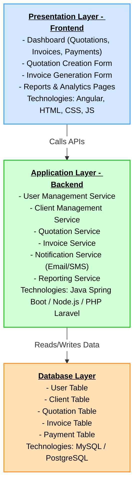
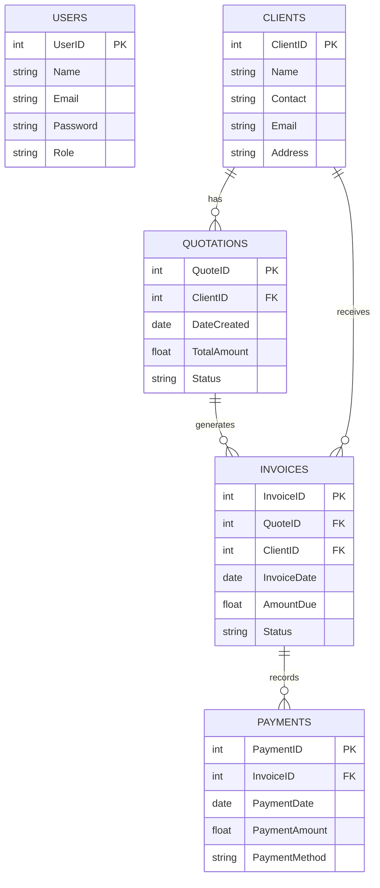
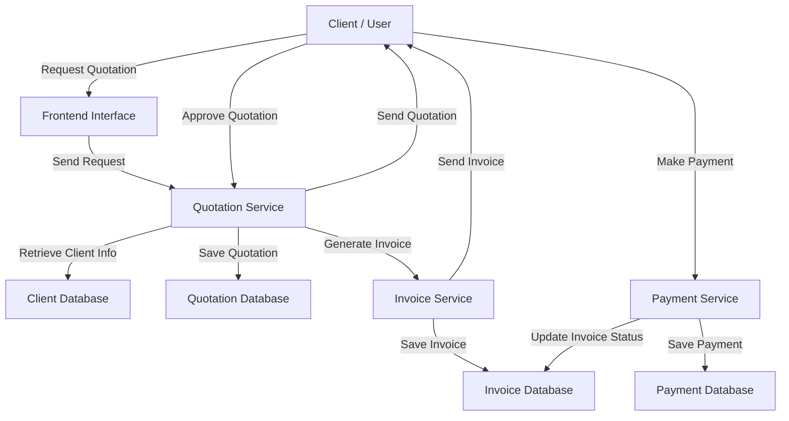

# Architecture



# Database



# Dataflow Diagram



# 2.2 System Interaction Diagram (SID)

```mermaid
sequenceDiagram
    participant Client as Client/User
    participant Frontend as Frontend UI
    participant Backend as Backend Services
    participant DB as Database

    Client->>Frontend: Login / Request Quotation
    Frontend->>Backend: Validate User / Process Request
    Backend->>DB: Retrieve Client Details
    DB-->>Backend: Return Client Data
    Backend->>DB: Save Quotation
    Backend-->>Frontend: Send Quotation Confirmation
    Frontend-->>Client: Display Quotation

    Client->>Frontend: Approve Quotation
    Frontend->>Backend: Generate Invoice
    Backend->>DB: Save Invoice
    Backend-->>Frontend: Send Invoice
    Frontend-->>Client: Display Invoice

    Client->>Frontend: Make Payment
    Frontend->>Backend: Process Payment
    Backend->>DB: Save Payment & Update Invoice Status
    Backend-->>Frontend: Payment Confirmation
    Frontend-->>Client: Display Payment Status

