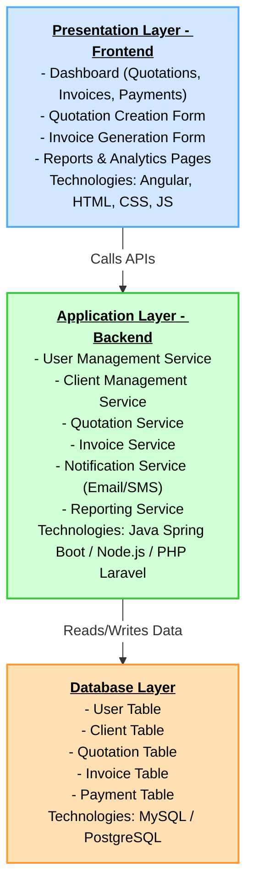
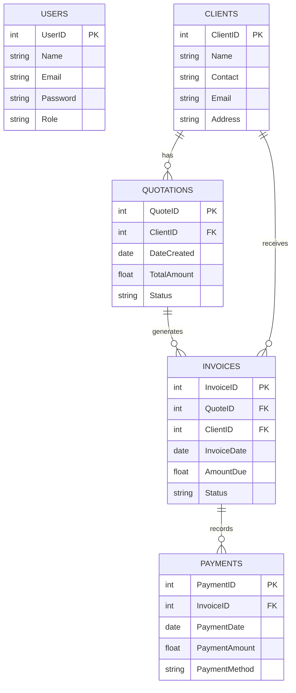
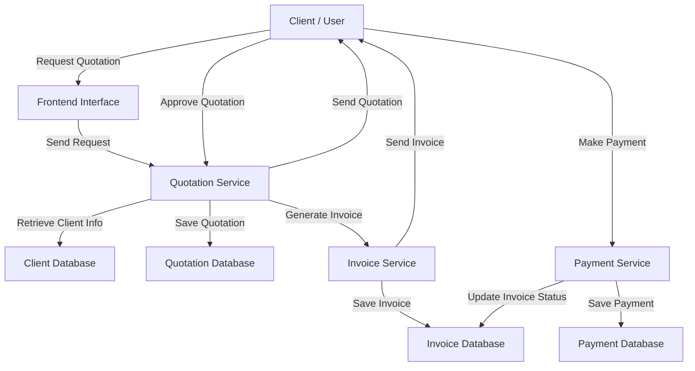
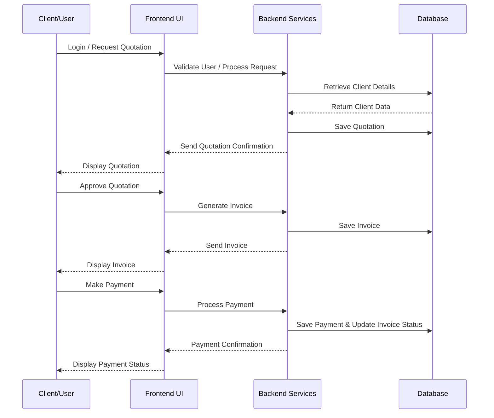
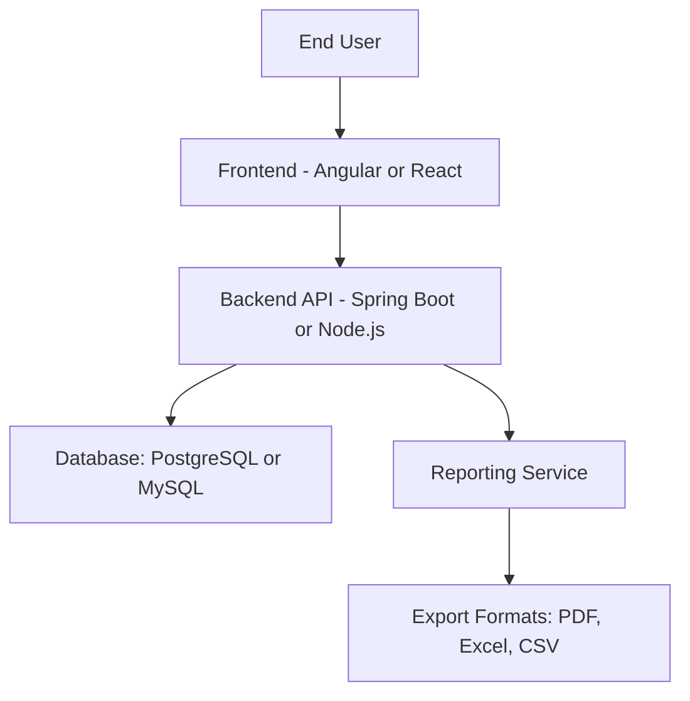
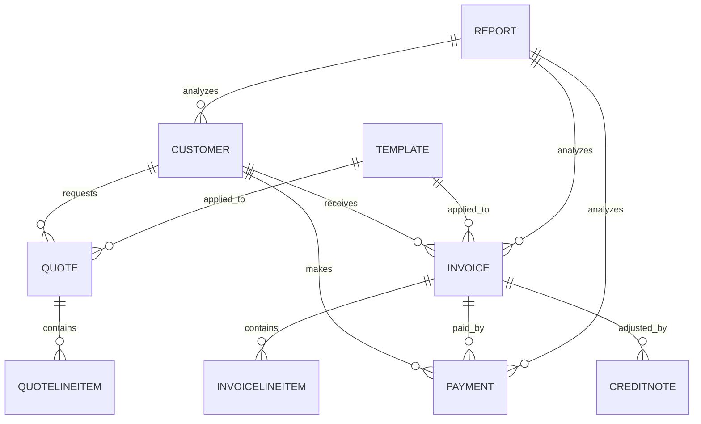
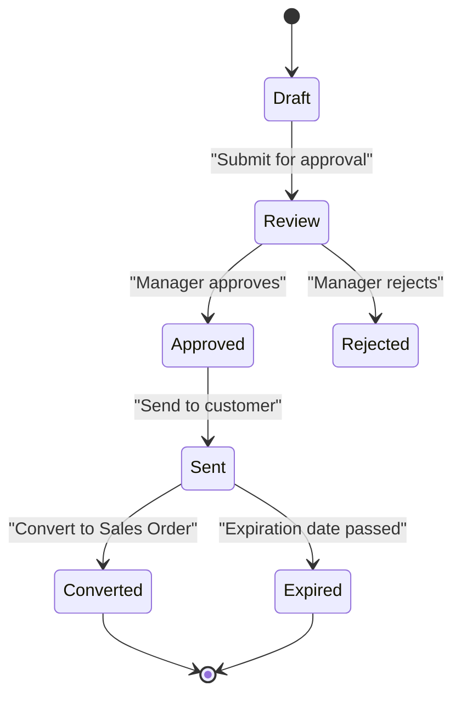
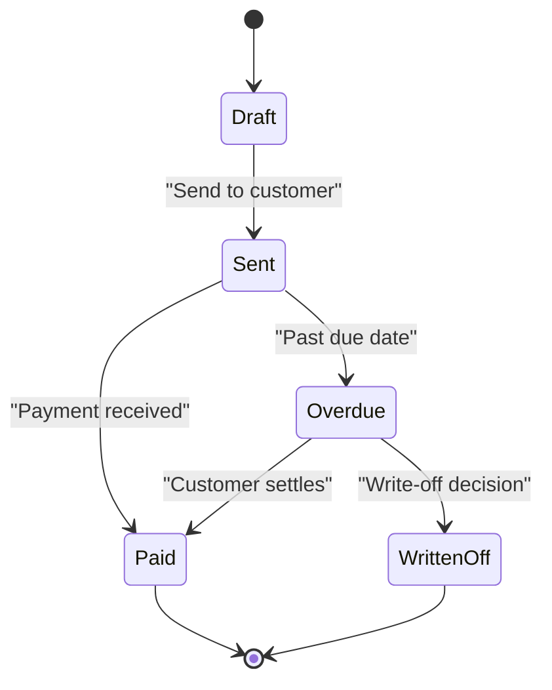
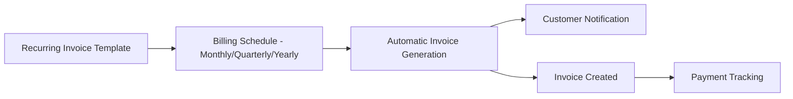
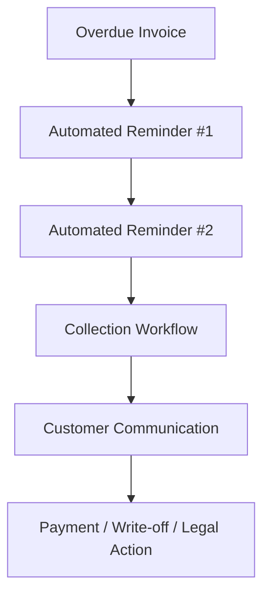

# Architecture



# Database



# Dataflow Diagram



# 2.2 System Interaction Diagram (SID)



# NEW

## High-Level Architecture


## Entity Relationship Diagram (ERD)


## Quote Workflow


## Invoice Workflow


## Recurring Invoice Workflow


## Overdue Collection Workflow


## Reporting Dashboard
```mermaid
flowchart TD
    Reports["Reports Module"] --> Aging["Invoice Aging Report"]
    Reports --> Sales["Sales Analysis"]
    Reports --> PaymentPerf["Payment Performance"]
    Reports --> Overdue["Overdue & Collections"]
    Reports --> Tax["Tax Reports"]
    Reports --> Custom["Custom Report Builder"]


